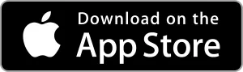

# Primeros pasos

## Instalemos la Wallet

  
  

La billetera de Bitcoin.com es una de las mas simples de usar y es la recomendada para iniciarse. La wallet viene por defecto con varias cadenas preinstaladas, BTC, BCH, y ETH.

La wallet Etherium, la cual incluye el token USDC que es una opción para tener dolares digitales, puede dejarla ya que tanto USDC cono USDT son monedas estables muy usadas y puede servir de puente entre diferentes wallets.

Vaya a carteras, elija la wallet BCH y presione los tres puntitos en la esquina superior derecha, se abrirán las preferencias de la wallet. En mostrar frase de recuperación tendrá las 12 palabras mencionadas anteriormente. Anotelas en un papel. Guardelo seguro.

En ajustes > preferencias podrá setear opciones de seguridad para que la app le pida autenticarse antes de ser usada, también encontrará la opción para setear la moneda alternativa, aquí podrá elegir el Peso Argentino.

## Fondear la wallet

La wallet puede ser fondeada de muchas maneras:

- Si tiene conocidos en la comunidad puede adquirir BCH por ese medio, intercambiando BCH por dinero FIAT.
- Billeteras virtuales custodiadas como [Fiwind](https://www.fiwind.io/) o [Lemon](https://lemon.me/) le permiten depositar pesos y adquirir cripto, si bien BCH no es aceptada en estas dos billeteras, es posible usar otra cripto como USDC/USDT como puente entre wallets custodia y nuestra wallet auto-custodia.

- Querés testearla? mandanos tu dirección Bitcoin Cash a info@Bitcoin Cash.ar que te mandamos unos \*satoshis de regalo!!

> \* 1BCH es igual a 100.000.000 satoshis

## Use los BCH

Ahora que tiene BCH, es hora de buscar un comercio cerca y comprar!

:world_map: [Mapa de comercios adheridos](https://www.mapa.bcharg.com/)

